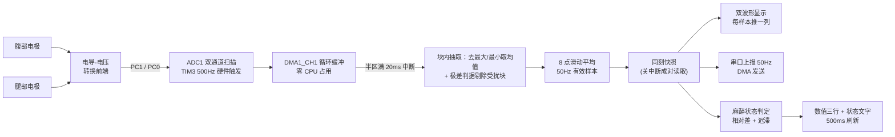

[README.md](https://github.com/user-attachments/files/32654795/README.md)[正在上传 README.md…]()
# 皮肤电导麻醉状态监测仪

基于 **STM32F103ZETx** 的双通道皮肤电导（GSR）实时监测设备：两路电极分别贴于腹部与腿部，采集皮肤电导变化，上电自动完成零点标定，在 320×240 液晶上同时显示两路数值、差值与双通道实时波形，并按两路相对差判定**麻醉状态**（麻醉完全 / 未麻醉完全），同时以 50Hz 经串口上报原始数据供上位机记录。

固件全部代码位于 [`code/firmware/`](code/firmware/)。

> 声明：本项目为竞赛/学习用途的原型系统，未做医疗电气安全与有效性验证，不可用于临床。

## 功能特性

- **双通道同步采集**：TIM3 硬件触发 500Hz 超采样，DMA 循环搬运零 CPU 占用，块内去极值抽取 + 8 点滑动平均得到 50Hz 有效样本
- **抗干扰两级过滤**：单点野值由"去最大/最小取均值"吸收；跨采样点的突发干扰由块内极差判据整块剔除，屏幕诊断行可直接校核剔除阈值
- **上电零点自标定**：每通道独立取 1s 静息均值作零点，量程 + 稳定性双重校验，不合格自动整窗重采，杜绝把接触瞬态当基线
- **实时双波形**：159 列差分推进（只重绘变化的列），绿/蓝双曲线约 3.2s 时窗
- **麻醉状态判定**：两路相对差 + 双阈值迟滞，避免临界值附近反复跳变
- **串口 DMA 上报**：50Hz 帧同步于有效样本，数值与屏幕逐字符一致，忙时丢帧不阻塞
- **全链路自恢复**：采集停摆、上报停摆双监测 + 分级恢复 + 整机复位兜底 + 独立看门狗，故障无需人工干预
- **故障可视化**：告警红块区分"正在发生的故障"与"已恢复的过去"，诊断行显示原始码值 / 标定均值 / 剔除计数

## 硬件组成

| 部件 | 型号 / 配置 | 说明 |
|---|---|---|
| 主控 | STM32F103ZETx | HSE 8MHz × PLL9 = **72MHz**，512KB Flash / 64KB RAM |
| 显示 | SSD1289 控制器 240×320 面板 | FSMC Bank4（NE4）16 位总线，RS 接 A0；横屏使用 320×240；PA1 背光 |
| 采集 | ADC1 双通道 PC1（电导1）/ PC0（电导2） | ADC 时钟 PCLK2/6 = 12MHz；DMA1_Channel1 循环模式 |
| 触发 | TIM3 | 72MHz/72/2000 = **500Hz** 硬件触发 ADC，采样间隔不受中断延迟抖动影响 |
| 上报 | USART1 PA9/PA10，115200 8N1 | TX 走 DMA1_Channel4，整帧一次交 DMA |
| 看门狗 | IWDG（寄存器级，≈1s 超时） | 不经 HAL 驱动，独立于业务代码 |
| 外围 | 两路电导-电压转换前端 | 量程 0..5µS，传输函数见下文 |

CubeMX 工程配置见 [`code/firmware/lcd.ioc`](code/firmware/lcd.ioc)（引脚 / 时钟 / 外设的最终事实源）。

## 系统架构

应用代码按"编排 + 功能模块"拆分：`main.c` 只保留初始化顺序、主循环节拍与错误处理，具体功能在 6 个 BSP 模块中实现。

| 文件 | 职责 |
|---|---|
| `Core/Src/main.c` | 初始化编排、主循环（喂狗 → 停摆监测 → 标定 → 消费样本 → 500ms 刷屏 → WFI 睡眠）、Error_Handler 原因码上屏 |
| `Core/Src/BSP/bsp_adc_acquire.c` | 采集链路：DMA 缓冲、块内抽取、干扰剔除、滑动平均、停摆监测与分级恢复 |
| `Core/Src/BSP/bsp_adc_cal.c` | 上电零点标定 + 电导换算（零点的唯一来源） |
| `Core/Src/BSP/bsp_uart_report.c` | 串口上报：帧组装、DMA 发送、停摆恢复 |
| `Core/Src/BSP/bsp_anes.c` | 麻醉状态判定（相对差 + 迟滞） |
| `Core/Src/BSP/bsp_fault.c` | 五类故障/劣化的时间窗标记（告警红块判据） |
| `Core/Src/BSP/bsp_iwdg.c` | 独立看门狗启动与喂狗 |
| `Core/Src/BSP/ssd1289_fsmc.c` | LCD 驱动 + 界面渲染：布局、数值格式化、双波形差分推进 |
| `Core/Src/{adc,dma,fsmc,gpio,tim,usart}.c` | CubeMX 生成的外设初始化（勿手改，改配置走 lcd.ioc 重新生成） |
| `Core/Inc/app_config.h` | 全部可调参数集中定义（每个参数附取值依据） |

### 数据流



### 显示布局

```
+--------------------------------+-----------------------------------+
| 皮肤电导1: 123.4               |                                   |
|                                |      双波形区 159×180              |
| 皮肤电导2: 56.7                |      绿 = 电导1                   |
|                                |      蓝 = 电导2                   |
| 电导差值: 66.7                 |      纵轴 0..60 单位               |
+--------------------------------+-----------------------------------+
|        麻醉完全 / 未麻醉完全 / CAL...          |■|  ← 告警红块       |
+--------------------------------------------------------------------+
| R1=xxxx R2=xxxx Z1=xxxx Z2=xxxx K=xxx   ← 诊断行（默认关闭）         |
+--------------------------------------------------------------------+
```

三行标签绿色固定，数值 0.5s 刷新；波形区与文本区由白色分隔线隔开；标定完成前数值留空、状态行显示 `CAL...`（最近一轮均值不合格时转红）。

## 工作原理

### 1. 采集链路（500Hz → 50Hz）

- **为什么用硬件触发**：采样时刻由 TIM3 直接驱动 ADC，与中断响应延迟无关，500Hz 时基稳定；
- **块内抽取**：每个 DMA 半区（2 通道 × 10 次触发 = 20ms）在中断里抽取为 1 个有效样本——去掉块内最大/最小后对剩余 8 点取均值，单点野值被自然吸收；
- **突发干扰剔除**：用"参与求均值的 8 个样本"的极差（次大-次小）做质量判据，超限则该块整块作废、显示值保持原值。阈值 = 绝对下限 + 相对比例 × 块内最小值，以适配传输函数在两端的非线性（参数 `ADC_BLOCK_SPREAD_*`）；
- **滑动平均**：8 点整数滑动平均（O(1) 更新，无软浮点），群延迟约 70ms；
- **消费同步**：`adc_seq` 逐样本递增，主循环按序号消费，不轮询不忙等，空闲进入 WFI 睡眠。

### 2. 零点标定与电导换算

前端传输函数（0..5µS 量程）：

```
G = 5 × (4095 − adc) / adc   (µS)
```

- 上电 1s 后开始取 50 个有效样本（= 1s @50Hz）求均值作各通道零点；
- 零点必须同时通过**量程校验**（均值落在 2048..4000 码）与**稳定性校验**（窗口极差 ≤ 200 码），且**两路同时合格**才锁定——传输函数在 adc 小的一端极陡（adc≈125 时 1 码 = 1.3µS），电极未接好时的均值绝不可当基线；
- 不合格整窗作废、自动重采，直到取得合格零点为止；
- 显示/上报口径：`(G − 本通道零点) × 30`，负电导统一截零。即数值是**相对基线的变化标度**（1 单位 = 1/30 µS），两路零点各自对齐后，差值判据才有意义。

### 3. 麻醉状态判定

采用**两路相对差** `|G1−G2| / max(G1,G2)` 而非绝对差——绝对差随电极/部位基线漂移，相对差把不同基线归一到同一尺度：

- 相对差 ≥ 60%（两路相差 ≥ 2.5 倍）→ **麻醉完全**
- 相对差 ≤ 50%（相差 ≤ 2 倍）→ **未麻醉完全**
- 两者之间保持原状态（迟滞带宽 10 个百分点，远大于噪声对应的相对差，临界值不会反复翻转）

### 4. 串口上报协议（上位机对接）

- 波特率 115200 8N1，每帧与有效样本同步（50Hz），格式：

```
<电导1>，<电导2>\n
```

- 数值经与屏幕**同一个**格式化函数（`LCD_ValStr`）输出：小数位随量级自适应（<10 两位、<100 一位、其余整数），上限 1999.99。**上位机必须按"格式无关"解析，不能按固定小数位切分**；
-分隔符在`app_config.h`的`UART_FRAME_SEP`一处可换（默认UTF-8全角逗号`，`；GBK环境换`0xA3 0xAC`；纯ASCII上位机换半角`,`）；
- 上一帧未发完则丢帧（忙时丢弃、不阻塞主循环），另有停摆监测兜底（见下）。

## 可靠性设计（答辩重点）

嵌入式采集设备最致命的失效是"**看起来正常、实际已停摆**"——主循环还在跑、屏幕还在刷，但数据链路死了。本设计对采集与上报两条链路都做了完整的"监测 → 分级恢复 → 兜底"闭环：

| 失效场景 | 监测手段 | 恢复动作 |
|---|---|---|
| ADC/DMA 传输错误（DMA TE 后通道硬件停转、HAL 关闭全部 DMA 中断） | 错误回调留痕 + `adc_seq` 心跳 | 停摆监测统一执行恢复序列 |
| 采集链路死透（seq 完全不增长，300ms） | 判据①：心跳超时 | 就地重启：停 TIM3 → 停 ADC/DMA → 手动清 HAL 残留的错误状态位 → 重校准 → 重启 → 开 TIM3 |
| 采集链路静默劣化（seq 仍增长但速率掉到 25Hz——HAL 的 F1 DMA TE 状态位残留缺陷所致，仅判据①永远发现不了） | 判据②：1s 统计窗口样本数 < 40，且连续两窗偏低 | 同上；恢复后时间窗重新起算，"半速"latch 保留 |
| 短窗口内连续恢复失败（10s 内 3 次） | burst 计数 | `NVIC_SystemReset()` 整机复位 |
| 串口 gState 永久卡 BUSY_TX（TC 收尾中断任何一步没走到，之后每帧静默丢弃） | 心跳：距上次成功发起发送 > 300ms | 阻塞式中止 + 寄存器级强制复位 DMA 通道状态（不信任 HAL 状态机）+ 立即补发最后一帧 |
| 上述任一未兜住的 late-stage 卡死 | IWDG ≈1s（寄存器级配置，独立于 HAL 与业务代码） | 自动复位 |

配套机制：

- **故障可视化不撒谎**：五个故障时间戳（ADC/DMA 错误、采集停摆、上报停摆、干扰剔除、丢样本）只增不减，告警红块改看"10s 时间窗内是否发生过"——故障结束后红块自动熄灭，"已恢复的过去"与"正在发生的现在"在屏上可区分；
- **诊断行**：`R1/R2`（当前原始码值）、`Z1/Z2`（标定窗口均值）、`K`（被剔除的受扰块数），现场校核阈值时无需改宏重编译；
- **数据一致性三保证**：① 波形与串口取自**同一关中断快照**（两处字面必然一致）；② 屏幕数值与串口数值走**同一个格式化函数**；③ 负电导截零统一在换算单点完成（不会出现"两路都显示 0、差值却显示几十"的自相矛盾）；
- **错误处理原因码**：初始化失败时直接读取硬件状态（振荡器就绪位 + 外设时钟使能位）并将其组成位图显示在屏幕上（`ERR=xx`），无需在 CubeMX 生成的代码中插入调试代码；当 LCD 尚未就绪时，交由看门狗自动复位后重新启动；
- **编译期参数自检**：`app_config.h` 中 `#error` 防止把抽取比/滤波窗调成除零。

> 演示提示：告警与诊断行由 `app_config.h` 的 `ALARM_SHOW` / `ADC_DEBUG_SHOW_RAW` 控制，出厂默认关闭以保证读数干净，演示抗扰/故障恢复时置 1 重新编译即可。

## 目录结构

```
gsr/
└── code/
    └── firmware/
        ├── Core/
        │   ├── Inc/                 # 应用配置 app_config.h + CubeMX 头文件
        │   │   └── BSP/             # 6 个功能模块 + LCD 驱动的对外接口、字库
        │   ├── Src/                 # main.c（编排）+ CubeMX 外设初始化
        │   │   └── BSP/             # 6 个功能模块实现 + SSD1289 LCD 驱动
        │   └── Startup/             # 启动文件与中断向量表
        ├── Drivers/                 # ST HAL 库与 CMSIS（官方原样，未改动）
        ├── lcd.ioc                  # CubeMX 工程配置（引脚/时钟/外设事实源）
        ├── STM32F103ZETX_FLASH.ld   # 链接脚本（Flash/RAM 布局）
        └── tools/                   # 构建与验证脚本（见下）
```

## 构建与烧录

**环境**：STM32CubeIDE（含内置 GNU Arm 工具链）、Windows（验证脚本需 PowerShell 与 Python 3）。

1. **IDE 构建**：STM32CubeIDE → 导入现有项目 → 选择 `code/firmware` → 构建 → 烧录；
2. **命令行全量检查**（不依赖 IDE，直接调 CubeIDE 工具链编译全部源文件并链接）：

   ```powershell
   pwsh -File code/firmware/tools/build_check.ps1
   ```

3. **逻辑回归**（用 Python 逐条复刻 C 实现，参数直接从源码读取防止测试与实现脱节）：

   ```bash
   python代码/固件/工具/verify_logic.py
   ```

4. **中断接线核对**（解析上一步生成的 ELF 与向量表，确认每个使能的 NVIC 中断都接到真实处理函数而非 weak 默认handler）：

   ```bash
   python代码/固件/工具/verify_irq.py
   ```

任何一次改动后建议跑完 2→3→4 三步再提交。

## 关键参数速查（`Core/Inc/app_config.h`）

| 参数 | 默认值 | 含义 |
|---|---|---|
| `ADC_BLOCK_TRIG` | 10 | 每半区触发次数，块时长 20ms |
| `FILT_N` | 8 | 滑动平均窗长（群延迟 ≈70ms） |
| `ADC_BLOCK_SPREAD_ABS / PCT` | 200 / 5 | 受扰块判据：绝对下限（码）+ 相对比例 |
| `ADC_STALL_RECOVER_MS` | 300 | 采集心跳超时判停摆 |
| `ADC_STALL_RATE_WIN_MS / MIN_SAMPLES` | 1000 / 40 | 劣化判据：1s 窗内样本数下限 |
| `ADC_STALL_BURST_MS / RESET_LIMIT` | 10000 / 3 | 连续失败窗口与整机复位上限 |
| `UART_STALL_RECOVER_MS` | 300 | 上报心跳超时判停摆 |
| `ALARM_WINDOW_MS` | 10000 | 告警红块时间窗 |
| `ALARM_SHOW / ADC_DEBUG_SHOW_RAW` | 0 / 0 | 告警与诊断行开关（演示时置 1） |
| `G_RANGE_MAX` | 60 | 波形纵轴满量程（相对量单位） |
| `G_STATE_ON_PCT / OFF_PCT` | 60 / 50 | 麻醉判定进入/退出阈值（迟滞） |
| `CAL_START_MS / SAMPLES` | 1000 / 50 | 标定起始时刻与窗口样本数 |
| `CAL_ADC_MIN / MAX / SPREAD_MAX` | 2048 / 4000 / 200 | 零点量程与稳定性校验 |
| `UART_FRAME_SEP` | `，`（UTF-8） | 帧分隔符（GBK / ASCII 可选值见源码注释） |

每个参数的源码注释里都写了**取值依据与调整后果**，调参前先读注释。

## 答辩准备要点

按"为什么这样设计"组织的要点清单，均可在代码中找到对应实现与注释：

1. **采样时基为什么稳**——TIM3 硬件触发 ADC，不经过中断，500Hz 节拍无抖动（`tim.c`、`bsp_adc_acquire.c`）；
2. **50Hz 有效样本怎么来的、抗干扰分几层**——500Hz 超采 → 去极值均值（挡单点野值）→ 极差判据整块剔除（挡跨点突发干扰）→ 8 点滑动平均（压高频噪声），每层职责不同、互不替代（`bsp_adc_acquire.c` 的 `adc_block_reduce` / `gfilter`）；
3. **为什么必须校验零点、为什么两路信号要同时通过**——传输函数在 adc 小端极陡，坏基线会让两路永远显示 0 而差值几十；两路零点取自同一时刻，差值判据才成立（`bsp_adc_cal.c`、`app_config.h` 的 `CAL_*` 注释）；
4. **数据一致性**——同刻快照 + 屏/串口共用格式化 + 截零单点化，展示时屏幕与上位机逐字一致可现场验证（`bsp_adc_cal.c` 的 `adc_read_g_pair`、`ssd1289_fsmc.c` 的 `LCD_ValStr`）；
5. **“假死”失效模式及对策**——DMA TE 后 HAL 在 F1 上留下状态位残留（有源码行号依据），导致 25Hz 半速静默劣化，仅靠"心跳停了"发现不了；本项目用双判据 + latch + 分级恢复 + 复位兜底闭环（`bsp_adc_acquire.c` 的 `adc_stall_monitor` / `adc_stall_recover`，注释含 HAL 源码定位）；
6. **告警为什么看时间窗而不是计数器**——计数器只增不减，一次上电瞬态会让红块永久常亮；时间窗让"已恢复的过去"自动熄灭（`bsp_fault.c` 的 `mark_alive`）;
7. **质量保障**——全量编译检查、逻辑仿真回归、中断接线核对三层脚本，改动必跑（`tools/`）。

## 面向开发者

- **新增应用功能**：在 `Core/Src/BSP/` 建独立模块，对外接口放 `Core/Inc/BSP/`，`main.c` 只做编排——保持"编排与实现分离"的既有结构；
- **修改外设配置**：改 `lcd.ioc` 后重新生成，不要手改 `Core/Src/{adc,dma,...}.c` 的生成区；手写代码全部在 `USER CODE BEGIN/END` 区或 BSP 模块内，重新生成不会丢失；
- **调参**：只动 `app_config.h`，每个参数上方注释说明了含义、依据与副作用；
- **上位机开发**：见「串口上报协议」一节，注意数值格式自适应与分隔符编码两个坑。
