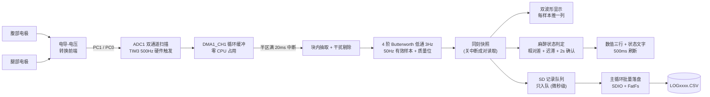

# 皮肤电导麻醉状态监测仪

基于 **STM32F103ZETx** 的双通道皮肤电导（GSR）实时监测设备：两路电极分别贴于腹部与腿部，采集皮肤电导变化，上电自动完成零点标定，在 320×240 液晶上同时显示两路数值、差值与双通道实时波形，并按两路相对差判定**麻醉状态**（麻醉完全 / 未麻醉完全）。测量过程自动触发并以 50Hz 记录到 **SD 卡 CSV**（每次测量一个 `LOGxxxx.CSV`），供事后分析；USART1 输出 `[SD]` 诊断信息。

固件全部代码位于 [`code/firmware/`](code/firmware/)。

> 声明：本项目为竞赛/学习用途的原型系统，未做医疗电气安全与有效性验证，不可用于临床。

## 功能特性

- **双通道同步采集**：TIM3 硬件触发 500Hz 超采样，DMA 循环搬运零 CPU 占用，块内去极值抽取 + 4 阶 Butterworth 低通得到 50Hz 有效样本
- **抗干扰两级过滤**：单点野值由"去最大/最小取均值"吸收；跨采样点的突发干扰由块内极差判据整块剔除并置质量位——波形留缺口、CSV 记 `Q=0`，不会把旧值当成新样本
- **上电零点自标定**：每通道独立取 1s 静息均值作零点，量程 + 稳定性双重校验，不合格自动整窗重采，杜绝把接触瞬态当基线
- **实时双波形**：159 列差分推进（只重绘变化的列），绿/蓝双曲线约 3.2s 时窗
- **麻醉状态判定**：两路相对差 + 双阈值迟滞 + 持续时间确认（进入/退出各 2s），临界值附近不反复跳变
- **SD 卡自动记录**：双阈值判定"测量开始/结束"，每次测量一个 `LOGxxxx.CSV`（9 列，含原始电导 µS、零点与质量位）；采样只入队、主循环批量落盘，掉电最多丢 1 秒数据
- **热插拔与坏卡自恢复**：卡不在位/写失败不影响采集与显示；插卡自动挂载，坏卡退避重试
- **全链路自恢复**：采集停摆双判据监测 + 分级恢复 + 整机复位兜底 + 独立看门狗，故障无需人工干预
- **故障可视化**：告警红块区分"正在发生的故障"与"已恢复的过去"，红色 `REC` 指示记录状态

## 硬件组成

| 部件 | 型号 / 配置 | 说明 |
|---|---|---|
| 主控 | STM32F103ZETx | HSE 8MHz × PLL9 = **72MHz**，512KB Flash / 64KB RAM |
| 显示 | SSD1289 控制器 240×320 面板 | FSMC Bank4（NE4）16 位总线，RS 接 A0；横屏使用 320×240；PA1 背光 |
| 采集 | ADC1 双通道 PC1（电导1）/ PC0（电导2） | ADC 时钟 PCLK2/6 = 12MHz；DMA1_Channel1 循环模式 |
| 触发 | TIM3 | 72MHz/72/2000 = **500Hz** 硬件触发 ADC，采样间隔不受中断延迟抖动影响 |
| 存储 | SD 卡（SDIO 4 位） | PC8–PC11 = D0–D3，PC12 = CK，PD2 = CMD，PC6 = NCD 卡检测；识别后 4.5MHz（SDIOCLK=72MHz，CLKDIV=14）；板载卡座标称 ≤2GB（SDSC，FAT16 预先在电脑上格式化） |
| 诊断 | USART1 PA9/PA10，115200 8N1 | 仅阻塞式诊断输出（`[SD]` 行），无 DMA、无中断 |
| 看门狗 | IWDG（寄存器级，≈1s 超时） | 不经 HAL 驱动，独立于业务代码 |
| 外围 | 两路电导-电压转换前端 | 量程 0..5µS，传输函数见下文 |

CubeMX 工程配置见 [`code/firmware/lcd.ioc`](code/firmware/lcd.ioc)（引脚 / 时钟 / 外设的事实源）；SDIO 的 GPIO 与外设初始化在 `bsp_sd.c` 中手动完成（.ioc 未配置 SDIO 外设），因此重新生成代码不会动到它。

## 系统架构

应用代码按"编排 + 功能模块"拆分：`main.c` 只保留初始化顺序、主循环节拍与错误处理，具体功能在 BSP 模块中实现。

| 文件 | 职责 |
|---|---|
| `Core/Src/main.c` | 初始化编排、主循环（喂狗 → 停摆监测 → 标定 → SD 任务 → 消费样本 → 500ms 刷屏 → WFI 睡眠）、Error_Handler 原因码上屏 |
| `Core/Src/BSP/bsp_adc_acquire.c` | 采集链路：DMA 缓冲、块内抽取、干扰剔除、Butterworth 低通、停摆监测与分级恢复 |
| `Core/Src/BSP/bsp_adc_cal.c` | 上电零点标定 + 电导换算（零点的唯一来源） |
| `Core/Src/BSP/bsp_sd.c` | SD 卡底层：SDIO 初始化、卡识别、4 位总线、扇区读写、在位检测 |
| `Core/Src/BSP/bsp_sdlog.c` | CSV 记录：起停判定（双阈值+迟滞）、环形队列、批量落盘、拔插卡处理、诊断输出 |
| `Core/Src/BSP/bsp_anes.c` | 麻醉状态判定（相对差 + 迟滞 + 持续时间确认） |
| `Core/Src/BSP/bsp_fault.c` | 四类故障/劣化的时间窗标记（告警红块判据） |
| `Core/Src/BSP/bsp_iwdg.c` | 独立看门狗启动与喂狗 |
| `Core/Src/BSP/ssd1289_fsmc.c` | LCD 驱动 + 界面渲染：布局、数值格式化、双波形差分推进、REC 指示 |
| `Middlewares/Third_Party/FatFs/src` | FatFs（8.3 短名、GBK 代码页、无 RTC），`diskio.c` 适配到 `bsp_sd.c` |
| `Core/Src/{adc,dma,fsmc,gpio,tim,usart}.c` | CubeMX 生成的外设初始化（勿手改，改配置走 lcd.ioc 重新生成） |
| `Core/Inc/app_config.h` | 全部可调参数集中定义（每个参数附取值依据） |

### 数据流



### 显示布局

```
+--------------------------------+-----------------------------------+
| 皮肤电导1: 123.4               |                                   |
|                                |      双波形区 159×180              |
| 皮肤电导2: 56.7                |      绿 = 电导1                   |
|                                |      蓝 = 电导2                   |
| 电导差值: 66.7                 |      纵轴 0..60 单位               |
+--------------------------------+-----------------------------------+
|  麻醉完全 / 未麻醉完全 / CAL...       REC  ■                       |
+--------------------------------------------------------------------+
```

三行标签绿色固定，数值 0.5s 刷新；波形区与文本区由白色分隔线隔开；标定完成前数值留空、状态行显示 `CAL...`（最近一轮均值不合格时转红）。状态行右端：`REC`（红字，正在写卡）与告警红块（16×16，时间窗内有故障）互不重叠，且 `REC` 不受告警总开关约束。

## 工作原理

### 1. 采集链路（500Hz → 50Hz）

- **为什么用硬件触发**：采样时刻由 TIM3 直接驱动 ADC，与中断响应延迟无关，500Hz 时基稳定；
- **块内抽取**：每个 DMA 半区（2 通道 × 10 次触发 = 20ms）在中断里抽取为 1 个有效样本——去掉块内最大/最小后对剩余 8 点取均值，单点野值被自然吸收；
- **突发干扰剔除**：用"参与求均值的 8 个样本"的极差（次大-次小）做质量判据，超限则该块整块作废、显示值保持原值，同时置质量位供下游使用。阈值 = 绝对下限 + 相对比例 × 块内最小值，以适配传输函数在两端的非线性（参数 `ADC_BLOCK_SPREAD_*`）；
- **低通滤波**：4 阶 Butterworth，截止 3Hz（2 个双二阶级联，DF2T 结构）。5Hz −18.6dB、10Hz −46.5dB，运动伪迹与肌电集中的 1~10Hz 段被明显压制；群延迟约 139ms，阶跃过冲 11.2%。首样本预置为稳态，上电时不产生虚假阶跃；
- **消费同步**：`adc_seq` 逐样本递增，主循环按序号消费，不轮询不忙等，空闲进入 WFI 睡眠。

### 2. 零点标定与电导换算

前端传输函数（0..5µS 量程）：

```
G = 5 × (4095 − adc) / adc   (µS)
```

- 上电 1s 后开始取 50 个有效样本（= 1s @50Hz）求均值作各通道零点；
- 零点必须同时通过**量程校验**（均值落在 2048..4000 码）与**稳定性校验**（窗口极差 ≤ 200 码），且**两路同时合格**才锁定——传输函数在 adc 小的一端极陡（adc≈125 时 1 码 = 1.3µS），电极未接好时的均值绝不可当基线；
- 不合格整窗作废、自动重采，直到取得合格零点为止；
- 显示/记录口径：`(G − 本通道零点) × 30`，负电导统一截零。即数值是**相对基线的变化标度**（1 单位 = 1/30 µS），两路零点各自对齐后，差值判据才有意义。

### 3. 麻醉状态判定

采用**两路相对差** `|G1−G2| / max(G1,G2)` 而非绝对差——绝对差随电极/部位基线漂移，相对差把不同基线归一到同一尺度：

- 相对差 ≥ 60%（两路相差 ≥ 2.5 倍）→ **麻醉完全**
- 相对差 ≤ 50%（相差 ≤ 2 倍）→ **未麻醉完全**
- 两者之间保持原状态（迟滞带宽 10 个百分点，远大于噪声对应的相对差，临界值不会反复翻转）

**为什么还要持续时间确认**：迟滞只管幅度，前提是信号连续变化。静电与电极抖动是瞬时毛刺，一次越过阈值就翻转、下个周期又翻回来，迟滞挡不住。因此越阈必须持续够久才承认：

- 进入"麻醉完全"：连续 2s 都 ≥ 60%
- 退回"未麻醉完全"：连续 2s 都 ≤ 50%
- 中途掉回阈值内，计时清零重来

判定的调用周期是 500ms（主循环刷屏节拍），所以实际生效时间是 2.0~2.5s。另有第三层保护：两路都低于 1.0 显示单位（电极脱落）持续 10s，判定状态强制复位到"未麻醉完全"，避免陈旧计时把状态推过阈值。

### 4. SD 卡数据记录

**起停判定**（双阈值 + 迟滞，与麻醉判定同一思路）：

- 两路显示值取**较大者**，≥ `SDLOG_START_TH`（5.0 显示单位 ≈ 0.17µS）→ 立即开始记录；
- 持续 `SDLOG_STOP_HOLD_MS`（3s）≤ `SDLOG_STOP_TH`（2.0 单位 ≈ 0.067µS）→ 结束本次记录；
- 单阈值会在阈值附近反复开关、产生大量碎片文件；两路取较大者避免单侧起反应被另一侧平均值拉低而漏记。

**文件与格式**：

- 每次测量一个文件：`LOG0001.CSV`、`LOG0002.CSV`……上电挂载时扫描根目录已有 `LOGxxxx.CSV` 取最大序号续写（换卡后从头开始）；超过 9999 回绕到 1，会覆盖旧文件，需人工备份；
- 文件头写入单位、判据与每列含义，数据行一次测量内固定格式：

```
# GSR log fs=50Hz start_th=5.0
# t_ms: ms from this file's first sample (first row = 0)
# raw1,raw2: conductivity in uS, before zero offset
# off1,off2: zero offset in uS (fixed after power-on calibration)
# g1,g2,diff: display unit = (raw-off)*30; diff = abs(g1-g2)
# q: 1 = valid block, 0 = disturbed block rejected by range check
# t_ms,raw1,raw2,off1,off2,g1,g2,diff,q
0,2.312,2.198,2.281,2.179,0.930,0.570,0.360,1
20,2.315,2.201,2.281,2.179,1.020,0.660,0.360,1
```

- `t_ms`：相对**该文件第一个样本**的毫秒数，每个文件从 0 开始（32 位，单次记录约 49.7 天回绕）；
- `raw1/raw2`：未扣零点的绝对电导（µS）。有了它可事后完整重算，也能直接与文献的 µS 值对比；
- `off1/off2`：本次测量生效的零点（µS），上电标定后固定不变；
- `g1/g2`：显示单位 `(raw − off) × 30`，负值截零；`diff = |g1 − g2|`；固定三位小数（0.001 显示单位 ≈ 0.000033µS，远小于 ADC 有效分辨率）；
- `q`：该样本的质量位。`0` 表示这一块被干扰判据剔除，此时 `g` 保持上一块的值，波形上对应一列缺口；
- 数值格式化用整数拼字符串而非 `%f`：本工程链接 newlib-nano 且未开浮点 printf，`%f` 在运行期会输出空串，且编译、链接零警告，只有看 CSV 才发现整列是空的。

**采样与存储解耦**：

- `bsp_sdlog_feed()` 只做判定 + 入队（微秒级）；写卡在 `bsp_sdlog_task()` 里批量完成（每次最多 8 行）——一次扇区写是 ms 级，同步写会挤占主循环、跨过采样点（触发 `adc_drop_ms` 告警）并压缩波形时基；
- 队列 64 行 ≈ 1.28s 缓冲深度；队列满时丢**新**样本（丢旧会打乱时间顺序）；
- 每写 50 行（= 1s）`f_sync` 一次：掉电最多丢 1 秒数据；`f_open`/`f_sync`/`f_close` 等长 I/O 前先喂狗，避免 ≈1s 的 IWDG 在正常写入时误复位。

**卡管理**：

- 卡必须事先在电脑上格式化为 **FAT16**，固件**不自动格式化**（防误抹卡内其它数据）；
- 拔卡：检测到 NCD 变高 → 关文件、清队列、回到 IDLE（避免旧样本写进新文件造成时间戳错乱）；
- 插卡：自动重新初始化 + 挂载；挂载失败每 2s 重试一次，写/建文件失败按 1s 退避重试，错误诊断限速 5s 一条（防刷屏）；
- 无卡/坏卡不影响采集、显示与波形，只是不产生记录文件。

**串口诊断**（USART1，115200）：上电打印卡的识别结果（在位/就绪/类型/容量/文件系统/下一个文件名），记录开始/结束时打印 `[SD] REC start -> LOGxxxx.CSV` / `[SD] REC stop rows=N`，异常打印限速错误行。

## 可靠性设计（答辩重点）

嵌入式采集设备最致命的失效是"**看起来正常、实际已停摆**"——主循环还在跑、屏幕还在刷，但数据链路死了。本设计对采集与记录两条链路都做了完整的"监测 → 恢复 → 兜底"闭环：

| 失效场景 | 监测手段 | 恢复动作 |
|---|---|---|
| ADC/DMA 传输错误（DMA TE 后通道硬件停转、HAL 关闭全部 DMA 中断） | 错误回调留痕 + `adc_seq` 心跳 | 停摆监测统一执行恢复序列 |
| 采集链路死透（seq 完全不增长，300ms） | 判据①：心跳超时 | 就地重启：停 TIM3 → 停 ADC/DMA → 手动清 HAL 残留的错误状态位 → 重校准 → 重启 → 开 TIM3 |
| 采集链路静默劣化（seq 仍增长但速率掉到 25Hz——HAL 的 F1 DMA TE 状态位残留缺陷所致，仅判据①永远发现不了） | 判据②：1s 统计窗口样本数 < 40，且连续两窗偏低 | 同上；恢复后时间窗重新起算，"半速"latch 保留 |
| 短窗口内连续恢复失败（10s 内 3 次） | burst 计数 | `NVIC_SystemReset()` 整机复位 |
| SD 卡拔插 / 坏卡 / 写失败 | NCD 在位检测 + FatFs 返回码 | 拔卡关文件清队列；插卡自动重挂载；失败 1s 退避重试；错误诊断 5s 限速；不影响采集显示 |
| 写卡 I/O 拖慢主循环 | 采样只入队、批量落盘（每次 ≤8 行） | 波形时基不压缩；队列满丢新样本，如实计入告警 |
| 长 FatFs I/O 与 ≈1s 看门狗冲突 | `f_open`/`f_sync` 等长操作前喂狗 | 正常写入不被 IWDG 误复位 |
| 任一未兜住的 late-stage 卡死 | IWDG ≈1s（寄存器级配置，独立于 HAL 与业务代码） | 自动复位 |

配套机制：

- **故障可视化不撒谎**：四个故障时间戳（ADC/DMA 错误、采集停摆、干扰剔除、丢样本）只增不减，告警红块改看"10s 时间窗内是否发生过"——故障结束后红块自动熄灭，"已恢复的过去"与"正在发生的现在"在屏上可区分；
- **记录状态可见**：状态行 `REC` 红字在判定"开始记录"（样本已入队、文件即将/已经打开）后点亮；结束时等队列排空、文件真正关闭后才熄灭（不会提前告诉用户"已停"而卡还在写）；打开文件失败时状态转 ERROR、`REC` 不亮；
- **数据一致性三保证**：① 屏幕数值、波形与 SD 记录取自**同一关中断快照**；② 电导换算与负值截零只在 `g_of` 单点完成（不会出现"两路都显示 0、差值却显示几十"）；③ CSV 写入原始浮点值而非自适应格式化字符串，格式固定可解析，并附带质量位与零点；
- **Error_Handler 原因码**：初始化失败时直接读硬件事实（振荡器就绪位 + 外设时钟使能位）组成位图上屏（`ERR=xx`），不用插桩进 CubeMX 生成代码；LCD 未就绪时交给看门狗自动复位重来；
- **编译期参数自检**：`app_config.h` 中 `#error` 防止抽取比调小后除以 0，以及 SD 记录退出门限高于进入门限（迟滞写反）。

> 演示提示：告警红块由 `app_config.h` 的 `ALARM_SHOW` 控制，出厂默认关闭以保证读数干净，演示抗扰/故障恢复时置 1 重新编译即可；`REC` 指示不受该开关影响。

## 目录结构

```
gsr/
└── code/
    └── firmware/
        ├── Core/
        │   ├── Inc/                 # 应用配置 app_config.h + CubeMX 头文件
        │   │   └── BSP/             # 功能模块接口 + 字库
        │   ├── Src/                 # main.c（编排）+ CubeMX 外设初始化
        │   │   └── BSP/             # 采集/标定/判定/SD/日志/看门狗/LCD 实现
        │   └── Startup/             # 启动文件与中断向量表
        ├── Drivers/                 # ST HAL 库与 CMSIS（官方原样）
        ├── Middlewares/
        │   └── Third_Party/FatFs/   # FatFs 文件系统（diskio.c 已适配 bsp_sd.c）
        ├── docs/manual-kg/          # 开发板手册知识图谱（索引/引脚表/寄存器说明）
        ├── lcd.ioc                  # CubeMX 工程配置（引脚/时钟/外设事实源）
        ├── STM32F103ZETX_FLASH.ld   # 链接脚本（Flash/RAM 布局）
        └── tools/                   # 构建与验证脚本（见下）
```

## 构建与烧录

**环境**：STM32CubeIDE（含内置 GNU Arm 工具链）、Windows（验证脚本需 PowerShell 与 Python 3）。

1. **IDE 构建**：STM32CubeIDE → Import Existing Projects → 选择 `code/firmware` → Build → 烧录；
2. **命令行全量检查**（不依赖 IDE，直接调 CubeIDE 工具链编译 Core + HAL + FatFs 全部源文件并链接）：

   ```powershell
   pwsh -File code/firmware/tools/build_check.ps1
   ```

3. **逻辑回归**（用 Python 逐条复刻 C 实现，参数直接从源码读取防止测试与实现脱节，覆盖采集/滤波/标定/判定/SD 记录格式）：

   ```bash
   python code/firmware/tools/verify_logic.py
   ```

4. **中断接线核对**（解析上一步生成的 ELF 与向量表，确认每个使能的 NVIC 中断都接到真实处理函数而非 weak 默认 handler）：

   ```bash
   python code/firmware/tools/verify_irq.py
   ```

任何一次改动后建议跑完 2→3→4 三步再提交。

## 关键参数速查（`Core/Inc/app_config.h`）

| 参数 | 默认值 | 含义 |
|---|---|---|
| `ADC_BLOCK_TRIG` | 10 | 每半区触发次数，块时长 20ms |
| `ADC_BLOCK_SPREAD_ABS / PCT` | 200 / 5 | 受扰块判据：绝对下限（码）+ 相对比例 |
| `ADC_STALL_RECOVER_MS` | 300 | 采集心跳超时判停摆 |
| `ADC_STALL_RATE_WIN_MS / MIN_SAMPLES` | 1000 / 40 | 劣化判据：1s 窗内样本数下限 |
| `ADC_STALL_BURST_MS / RESET_LIMIT` | 10000 / 3 | 连续失败窗口与整机复位上限 |
| `ALARM_WINDOW_MS` | 10000 | 告警红块时间窗 |
| `ALARM_SHOW` | 0 | 告警红块上屏开关（演示时置 1） |
| `G_RANGE_MAX` | 60 | 波形纵轴满量程（相对量单位） |
| `G_STATE_ON_PCT / OFF_PCT` | 60 / 50 | 麻醉判定进入/退出阈值（迟滞） |
| `G_STATE_ON_HOLD_MS / OFF_HOLD_MS` | 2000 / 2000 | 越阈需持续多久才切换状态 |
| `G_STATE_IDLE_UNITS / IDLE_MS` | 1.0 / 10000 | 两路都低于此值持续多久则复位状态 |
| `CAL_START_MS / SAMPLES` | 1000 / 50 | 标定起始时刻与窗口样本数 |
| `CAL_ADC_MIN / MAX / SPREAD_MAX` | 2048 / 4000 / 200 | 零点量程与稳定性校验 |
| `SDLOG_START_TH_X10` | 50 | 记录开始阈值（5.0 显示单位 ≈0.17µS） |
| `SDLOG_STOP_TH_X10` | 20 | 记录结束阈值（2.0 显示单位 ≈0.067µS，必须小于开始阈值） |
| `SDLOG_STOP_HOLD_MS` | 3000 | 低于结束阈值持续多久才停（防碎片文件） |
| `SDLOG_QUEUE_LEN` | 64 | 记录队列深度（50Hz 下 ≈1.28s 缓冲） |
| `SDLOG_WRITE_PER_TASK` | 8 | 每轮主循环最多写多少行（限制单次占用） |
| `SDLOG_SYNC_EVERY` | 50 | 每写多少行 `f_sync`（=1s，掉电最多丢 1s） |
| `SDLOG_MAX_FILES` | 9999 | 文件名序号上限（回绕会覆盖旧文件，需备份） |

每个参数的源码注释里都写了**取值依据与调整后果**，调参前先读注释。

## 答辩准备要点

按"为什么这样设计"组织的要点清单，均可在代码中找到对应实现与注释：

1. **采样时基为什么稳**——TIM3 硬件触发 ADC，不经过中断，500Hz 节拍无抖动（`tim.c`、`bsp_adc_acquire.c`）；
2. **50Hz 有效样本怎么来的、抗干扰分几层**——500Hz 超采 → 去极值均值（挡单点野值）→ 极差判据整块剔除（挡跨点突发干扰）→ 4 阶 Butterworth 低通 3Hz（压 1~10Hz 的运动伪迹与肌电），每层职责不同、互不替代（`bsp_adc_acquire.c` 的 `adc_block_reduce` / `gfilter`）；
3. **零点为什么必须校验、为什么两路一起过**——传输函数在 adc 小端极陡，坏基线会让两路永远显示 0 而差值几十；两路零点取自同一时刻，差值判据才成立（`bsp_adc_cal.c`、`app_config.h` 的 `CAL_*` 注释）；
4. **数据一致性**——屏幕数值、波形、SD 记录取自同一关中断快照；CSV 写原始浮点值（固定三位小数）而不是自适应格式化字符串，现场可用同一段数据核对屏显与文件（`adc_read_sample`、`bsp_sdlog.c` 的 `fmt_f3`）；
5. **"假死"失效模式及对策**——DMA TE 后 HAL 在 F1 上留下状态位残留（有源码行号依据），导致 25Hz 半速静默劣化，仅靠"心跳停了"发现不了；本项目用双判据 + latch + 分级恢复 + 复位兜底闭环（`bsp_adc_acquire.c` 的 `adc_stall_monitor` / `adc_stall_recover`）；
6. **SD 记录为什么这样设计**——采样与存储解耦（只入队，避免 ms 级扇区写打断 20ms 采样节拍）、双阈值+迟滞自动起停（避免碎片文件）、每 1s 落盘（掉电最多丢 1s）、不自动格式化（防误抹）、热插拔与退避重试（坏卡不拖垮主循环）；`%f` 在 newlib-nano 下输出空串的坑也已针对性规避（`bsp_sdlog.c` 文件头与 `fmt_f3` 注释）；
7. **告警为什么看时间窗而不是计数器**——计数器只增不减，一次上电瞬态会让红块永久常亮；时间窗让"已恢复的过去"自动熄灭（`bsp_fault.c` 的 `mark_alive`）；
8. **质量保障**——全量编译检查、逻辑仿真回归、中断接线核对三层脚本，改动必跑（`tools/`）。

## 面向开发者

- **新增应用功能**：在 `Core/Src/BSP/` 建独立模块，对外接口放 `Core/Inc/BSP/`，`main.c` 只做编排——保持"编排与实现分离"的既有结构；
- **修改外设配置**：改 `lcd.ioc` 后重新生成，不要手改 `Core/Src/{adc,dma,...}.c` 的生成区；手写代码全部在 `USER CODE BEGIN/END` 区或 BSP 模块内，重新生成不会丢失；SDIO 的 GPIO/时钟是手写在 `bsp_sd.c` 的（未纳入 .ioc），重新生成不会覆盖；
- **调参**：只动 `app_config.h`，每个参数上方注释说明了含义、依据与副作用；
- **数据分析 / 上位机开发**：直接解析 SD 卡上的 `LOGxxxx.CSV`——跳过 `#` 注释行，按表头读取 9 列（`t_ms,raw1,raw2,off1,off2,g1,g2,diff,q`），`q=0` 的行表示该块被干扰判据剔除；数值单位是"显示单位"（1 单位 = 1/30 µS，相对本通道上电基线），`t_ms` 为相对该文件第一个样本的毫秒数（每文件从 0 开始，采样周期约 20ms）。串口仅输出 `[SD]` 诊断文本，不再有 50Hz 数据流。
